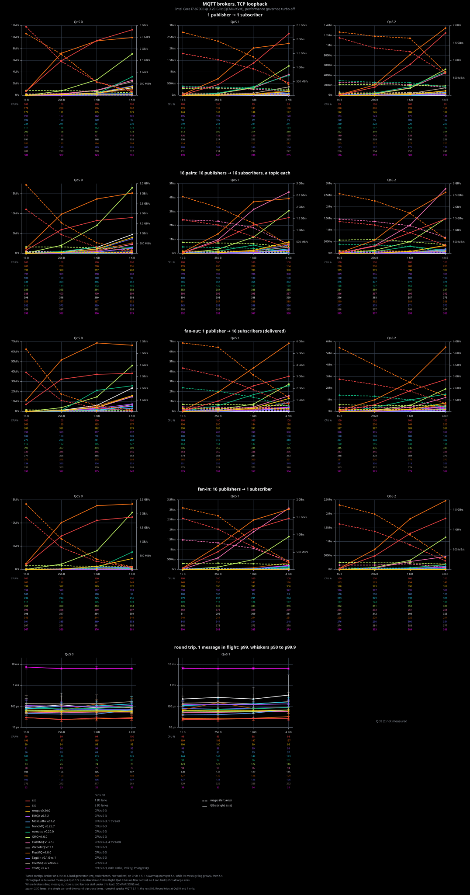
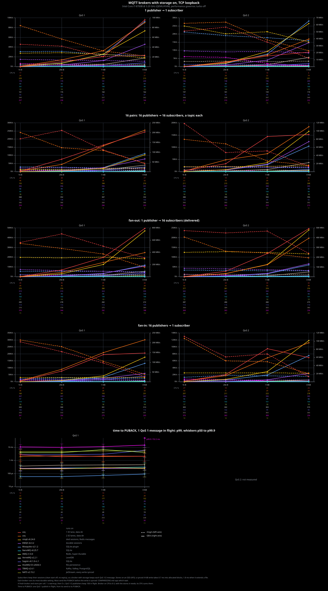
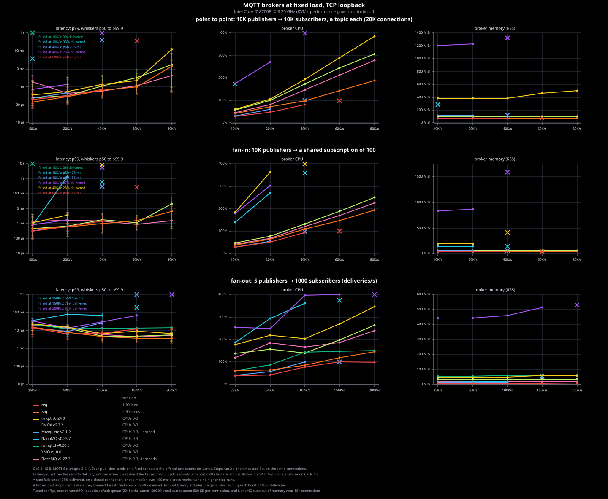
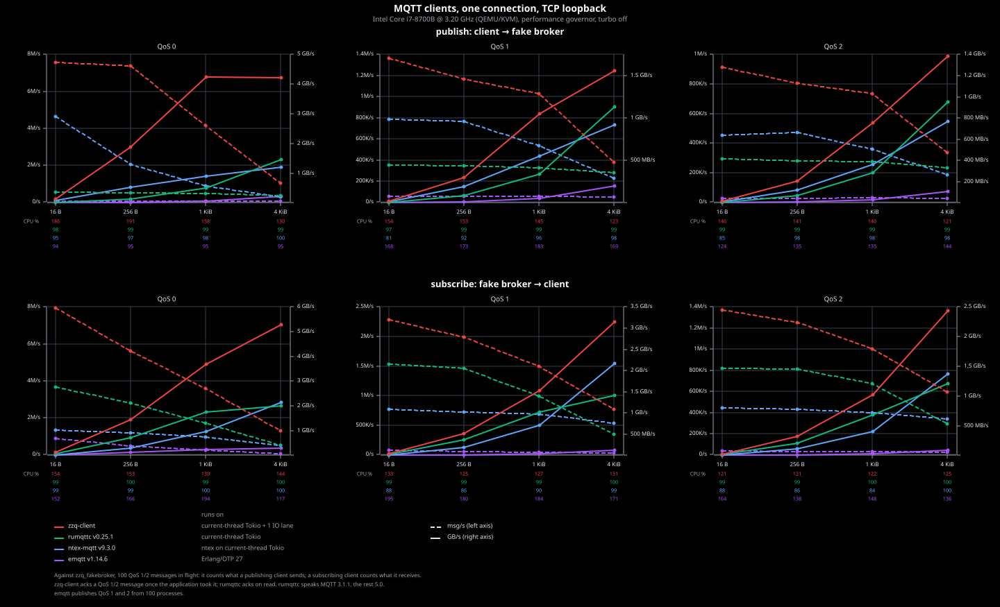

# Benchmarks

zzq against other MQTT brokers and clients on one machine, over TCP
loopback. [RUNNING_BENCHMARKS.md](RUNNING_BENCHMARKS.md) shows how to run
them.

## Setup

- Intel Core i7-8700B @ 3.20 GHz, QEMU/KVM guest with 6 vCPUs and 28 GiB,
  Debian 13, Linux 6.12, performance governor, turbo off.
- The broker runs on CPUs 0-3 (`taskset`), the load generator on CPUs 4-5.
  Brokers shipped as container images run in podman with host networking.
  The stores a broker needs (Redis, Kafka, PostgreSQL) run on its CPUs,
  and its CPU and memory include theirs.
- Before each run, the runner waits for 90% idle CPU and no compiler
  processes. A run that overlaps a compiler is repeated.
- Each cell is one run. The charts show the newest run per cell: zzq,
  HiveMQ CE, TBMQ and every run with storage on from 2026-10-28 and 29,
  the rest from 2026-10-26.
- Rivals run tuned configs: in-flight windows of about 1000, queues of about
  100K, no rate limits, and Nagle off where they have the knob. Several
  defaults drop messages or pace subscribers, which would measure the
  config, not the broker. Like the others, HiveMQ CE keeps its queues in
  RAM here; its default, file persistence, runs with storage on.
- zzq runs its defaults with 1 or 2 IO lanes. With 2 lanes, the single
  pair and the round trip cross lanes.

| Broker | Version | Language | Runs as |
| --- | --- | --- | --- |
| zzq | this repo | Rust | release build |
| rmqtt | 0.24.0 | Rust | source build |
| rumqttd | 0.20.0 | Rust | source build, MQTT 3.1.1 |
| EMQX | 6.3.2 | Erlang | official image |
| VerneMQ | 2.2.1 | Erlang | source build[^vernemq] |
| Mosquitto | 2.1.2 | C | official image |
| NanoMQ | 0.25.7 | C | official image |
| FlashMQ | 1.27.3 | C++ | source build, 4 threads |
| XMQ | 1.0.0 | C++ | official image |
| FluxMQ | 1.0.0 | Go | source build |
| Sagüin | 0.1.0-rc.1 | Go | source build |
| HiveMQ CE | 2026.5 | Java | official image |
| TBMQ | 2.4.1 | Java | official images, with Kafka, Valkey and PostgreSQL |

[^vernemq]: VerneMQ's binary packages and images come under an EULA that
    forbids competitive analysis. The source is Apache-2.0.

[COMPARISONS.md](COMPARISONS.md) lists how the other brokers behave under
this load, and why some configs differ from the tuned ones.

## Broker throughput and latency

- Load generator: `zzq_brokerbench` from `zzq-bench`, raw sockets, one
  thread per connection, pre-encoded batches. MQTT 5.0, except 3.1.1 for
  rumqttd.
- 1 s warmup (5 s for rumqttd, whose memory grows for a few seconds
  first), then a 5 s window. The rate is deliveries at the subscribers.
  Loss compares all deliveries with all sends once 2 s pass without a
  delivery, or 90 s after the publishers stop.
- QoS 1 and 2 publishers keep up to 100 messages in flight. QoS 0 has no flow
  control, so it shows how a broker handles a subscriber that falls behind.
- Round trip: one message in flight between two connections. The dot is
  p99, the whiskers p50 and p99.9, on a log axis.
- The CPU rows under each panel are the broker's CPU percent over the run,
  out of 400.

## Brokers with storage on

- Each broker runs its most durable storage setting, with its stores on
  an SSD (XFS). A synced 4 KiB write takes 0.7 ms into allocated blocks
  and 1.8 ms when it extends a file. zzq runs with `--data-dir`.
  [COMPARISONS.md](COMPARISONS.md#with-storage-on) has the numbers and
  which brokers send the PUBACK only after the write is synced.
- Subscribers keep their sessions (clean start off, no expiry), so a
  broker with storage keeps each QoS 1 and 2 message for them.
- Each cell gets a fresh broker and empty stores. The load is as above,
  at QoS 1 and 2.
- Time to PUBACK: one QoS 1 publish in flight, from its send to its
  PUBACK, with a persistent subscriber, on a log axis.
- Not run: rumqttd has no storage, FlashMQ only writes a snapshot each
  hour, and FluxMQ 1.0.0 refuses persistent sessions on one node.

## Fixed load with many connections

- Load generator: `zzq_loadbench` from `zzq-bench`, on two current-thread
  runtimes on CPUs 4-5, up to 20K connections from 127.0.0.1-8. QoS 1,
  16 B payloads.
- Each publisher sends on a fixed schedule. A step ramps for 2 s, then
  measures for 8 s on the same connections. The offered rate counts
  deliveries.
- Latency runs from the send to the delivery. If the broker held a message
  back (full in-flight window or blocked write), it runs from the time the
  message was due.
- A step fails below 95% delivered, on a closed connection, or at a median
  above 100 ms. A cross marks the failure, and the list right of the row
  says why. No higher step runs.
- Latency and memory are on log axes.
- Each scenario gets a fresh broker.

## Clients

- One client connection against `zzq_fakebroker` from `zzq-bench`, which
  acks at once. The receiving side measures: the fake broker for
  publishing, the client for subscribing.
- QoS 1 and 2 publishers keep up to 100 messages in flight.
