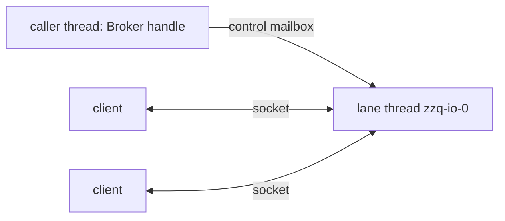
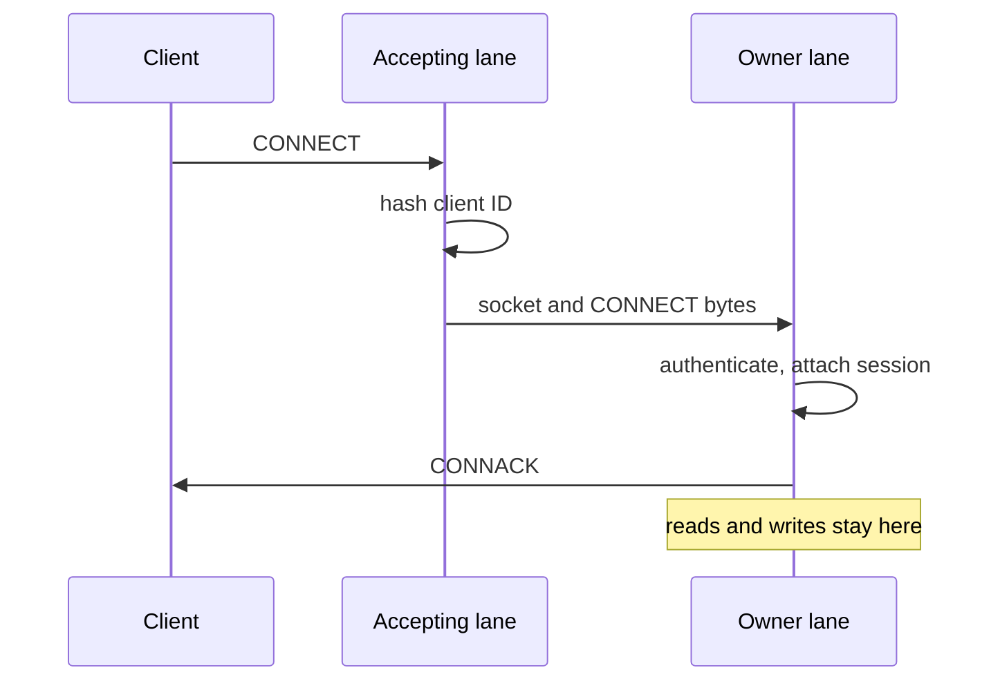
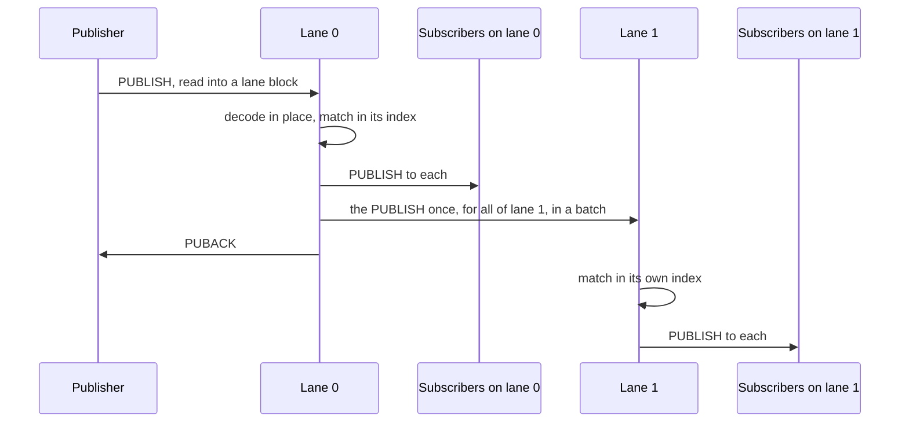
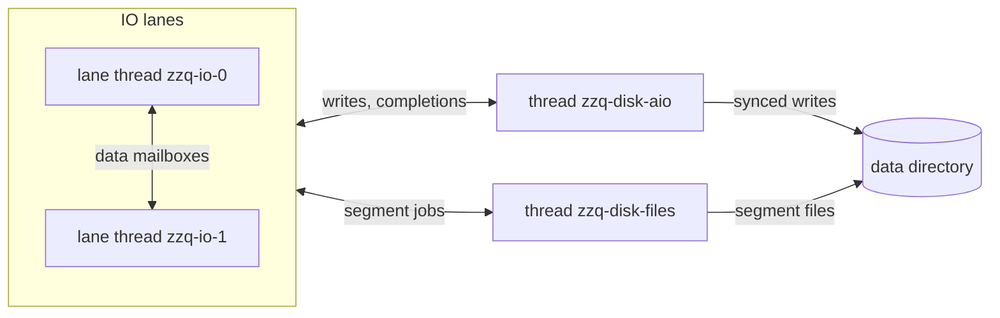
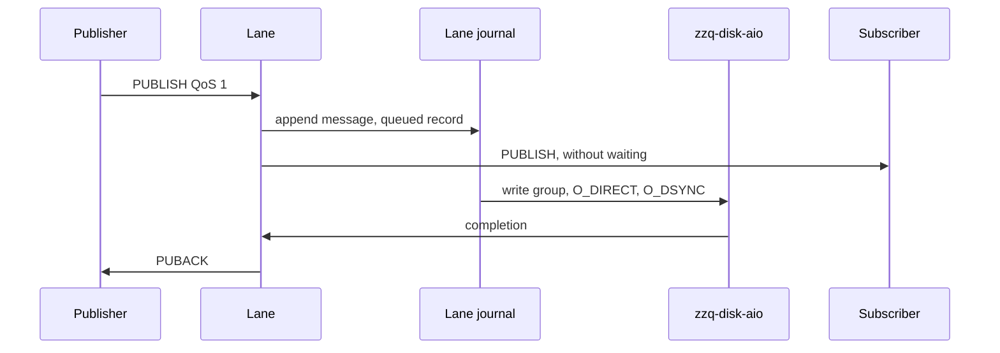
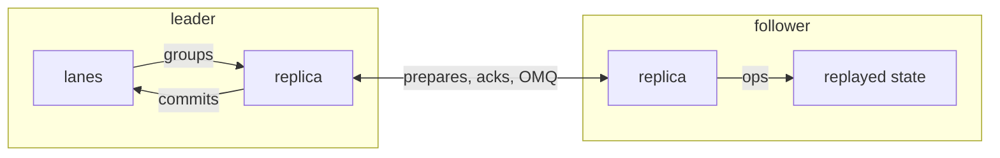

# Architecture

How the zzq broker is built: its threads, the queues between them, and the
path a message takes. [BENCHMARKS.md](../BENCHMARKS.md) has the numbers,
[COMPARISONS.md](../COMPARISONS.md) the behavior under load.

## Threads

| Thread | Count | Owns |
| --- | --- | --- |
| IO lane `zzq-io-N` | `--lanes`, 1 by default | Connections, sessions, a copy of the subscription index |
| Disk AIO `zzq-disk-aio` | One, with a data directory | Submitting journal writes and reaping them |
| Disk files `zzq-disk-files` | One, with a data directory | Making, reusing and trimming segment files |
| Files `zzq-files` | Short-lived | Opening the data directory, the state file at start and shutdown |
| Caller | Any | The `Broker` handle |

One lane, without a data directory:

- A lane is a thread with a current-thread Tokio runtime and a local task
  set. Its state is `Rc`/`RefCell`: no locks, no atomics on the message
  path.
- A session lives on the lane its client ID hashes to, and its connection
  runs there. Neither ever moves.
- Every lane holds all subscriptions, so it matches a publish without
  asking another lane.
- Retained messages belong to no lane. They sit in 8 stripes by topic,
  each a tree behind a lock of its own, which a lane takes for a retained
  publish or a subscribe.

## Tasks on a lane

| Task | Per | Does |
| --- | --- | --- |
| Accept loop | Listener, on one lane | Accepts, reads CONNECT, hands the socket to the owner lane |
| Read loop | Connection | Reads into the lane's blocks, hands whole packets to the lane |
| Writer | Connection | Writes the session's encoded output |
| Control loop | Lane | Subscription changes, broker publishes, congestion, stats, shutdown |
| Data loop | Lane | Publishes from other lanes, for its own sessions |
| Sweep | Lane, every 50 ms | Keep alive, expiry and the state budget, for a 20th of the sessions |
| Completions | Lane, with a data directory | Acks held for the disk |

## Channels

| Channel | From, to | Bound | Carries |
| --- | --- | --- | --- |
| Control mailbox | Lanes and handle to a lane | None | Subscription changes, broker publishes, congestion, stats, shutdown |
| Data mailbox | Lane to lane | 64 batches; senders wait | Forwarded PUBLISH packets, shared subscription deliveries |
| Writer wake | Lane to a connection's writer | One pending wake | Output is ready |
| Disk queues | Journals to the disk threads, and back | Bounded | Write groups, segment jobs, completions |

- A sender queues under a lock and wakes the lane only when the queue was
  empty. A burst costs one wake. The lane takes all that is queued.
- A data batch holds what one lane routed for another since its last
  send, at most one socket read (256 KiB) per connection. A full data
  mailbox makes the sending lane wait, which slows its publishers.
  Nothing is dropped.
- The lane handles controls in runs of 64, letting its connections run in
  between. Data batches it handles all at once: up to 64, with no byte
  cap of their own.
- A client queues at most one read of subscription changes: its
  connection reads on once every lane applied them.

## Connecting

- TCP, TLS and IPC sockets and QUIC streams move between lanes.
- WebSocket and MQTT-SN clients reach a lane through in-memory MQTT
  connections, fed by a task on the lane that accepted them.

## A publish

The publisher's client ID hashes to lane 0. Subscribers with a matching
filter are on both lanes.

- Topic and payload stay slices of the read block, also in a forward.
- A message a session keeps (queued, in flight, retained) is copied into
  the session's arena blocks, so it does not pin read blocks.
- A session encodes PUBLISH packets straight into its output. Its writer
  takes the whole output and writes it at once.
- Without a data directory, the PUBACK waits for nothing but a congested
  subscriber (see below). With one, it waits for the journals too.

## Backpressure

- **QoS 1 and 2.** Once a connected subscriber has `qos_queue_high` (1024)
  messages queued, the acks of the publishers that feed it are held, on
  every lane, until it is down to half. With a data directory, they are
  held after their journal writes too. Publishers slow to its pace.
- **QoS 0.** Past `max_out_bytes` (64 MiB) waiting for one connection,
  QoS 0 messages to it are dropped and counted.
- **Queues.** A session queues up to `max_queued` messages and
  `max_queued_bytes`, then drops its oldest. Held acks keep a connected
  subscriber far below that; an offline one reaches it. `max_state_bytes`
  bounds all sessions, queues and retained messages.

## Durability

With `--data-dir`, each lane journals its sessions that outlive their
connection, their subscriptions and their QoS 1 and 2 messages. Each
retained stripe journals its messages too, under its lock, and a task on
one of the lanes takes its completions. Two more threads do the disk
work for all journals:

- `zzq-disk-aio` submits the journals' write groups to the kernel with
  Linux AIO, reaps them, and tells each journal's lane.
- `zzq-disk-files` makes a journal's next segment, from a spare or newly
  allocated, turns trimmed segments into spares, and marks what is on
  disk. File work never holds up writes.

Two lanes with a data directory:

A QoS 1 publish to a session that outlives its connection:

- **Group commit.** With no write in flight, a journal sends what it has
  at once, even one record. Records appended meanwhile go out together in
  the next write.
- **One write, no fsync.** `O_DIRECT | O_DSYNC` writes through Linux AIO:
  a completed write is on disk.
- **Warm segments.** Trimmed segments become spares for later ones, so
  writes land in blocks written before. One spare stays back, so a full
  device cannot wedge a journal.
- **Snapshots.** Once a journal has written a segment's worth (64 MiB)
  and twice what is live, it starts a new segment with a snapshot of the
  live state, then trims the segments before.
- **Acks across lanes.** A publisher's ack also waits for every other
  lane that queued the message for a kept session to have it on disk.
- A connection with acks held for the disk reads on once those writes are
  done, so a publisher cannot outrun the journal. QoS 0 publishers wait
  only while records pile up for the disk.

## Clustering

Three nodes run as one broker, replicated with Viewstamped Replication
(`zzq-cluster`). The journals that would go to a data directory go to
the cluster instead, in RAM:

- **Ops.** Each flushed group of a lane's or a retained stripe's records
  becomes one op. A replica task on lane 0 owns the node, proposes the
  ops and turns their commits into the journals' completions, so a
  PUBACK waits for one follower to hold its message.
- **Leader only.** The leader alone binds client listeners. A node that
  loses the leadership closes them, drops its lanes' state and rebuilds
  it from the ops.
- **Followers.** A follower applies the committed ops with the replay a
  start from disk uses, into state no lane serves. Becoming leader hands
  that state to the lanes.
- **Images.** A node behind the ops the others keep, or without state,
  gets an image: each journal's state, cut at its own op.
- **Exit dumps.** A clean stop writes the node's history and an image to
  the state file; the next start votes with it.
- **Links.** The nodes talk over OMQ, one PEER socket per node, on a
  thread of its own.

## Why it is fast

- **Shared nothing.** A lane owns its connections and sessions, and holds
  the whole index. The message path takes no locks and no atomics.
- **One hop per lane, not per subscriber.** A publish crosses to another
  lane once, however many of its sessions match.
- **No copies, no allocations per message.** Packets are decoded in place
  from read blocks the lane reuses. Messages a session keeps go into arena
  blocks, which allocate per block. Forwards slice the read block.
- **Batches everywhere.** A lane takes all that is queued for it, a burst
  costs one wake, and a writer sends a session's whole output in one
  write.
- **Warm lanes.** After its tasks run, a lane keeps polling for 40 µs
  (`--spin-us`) before it sleeps, so a wake from another lane finds it
  awake and costs no syscall.
- **Match cache.** A lane caches the matches of topics it sees again.
- **Backpressure, not buffering.** Slow subscribers slow their publishers
  instead of growing queues, so memory stays flat under overload.
- **Disk writes the size of the load.** Group commit turns many acks into
  one synced write.
